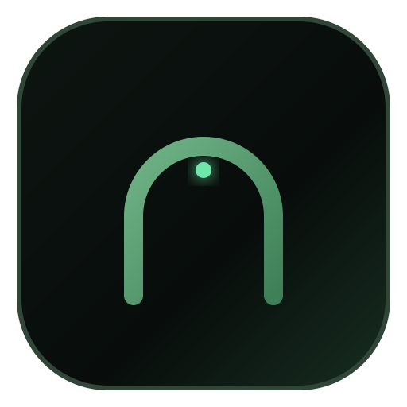

<p align="center">
  
</p>

# Hospitality POS

**Offline-first, multi-tenant point of sale built for Kenyan hospitality venues.**

Hospitality POS keeps restaurants, cafés, bars and hotels selling when the
internet does not. Every venue runs a small local edge server on the LAN; tablets
and tills open a fast PWA that talks only to that edge. Tables, menu, orders,
VAT and receipts stay available during outages, then sync to an optional cloud
control plane when connectivity returns.

Built Kenya-first: **KES**, **VAT**, **M-Pesa** (manual references and STK Push)
and **PDQ card terminals** are modelled as first-class payment flows. The default stack is
self-hosted and free to start — SQLite at the edge, Postgres or MySQL in the
cloud, with no paid SaaS required.

## Why it is different

- **Works offline by design.** The edge node is the source of truth for the
  venue; the cloud is optional, never a dependency for selling.
- **Tenant-scoped from day one.** Every query is filtered by tenant and venue,
  with isolation tests to prove it.
- **Touch-first.** Large targets, dark/light themes, and a luxury green visual
  system designed for shared tablets.
- **Kenya payments designed in.** Cash, manual M-Pesa, Daraja STK Push and PDQ
  card flows are modelled on one payment state machine and audit trail.
- **Zero paid baseline.** OSS libraries, free DB engines, self-hosted
  monitoring and GitHub Pages — the only expected recurring cost is a VPS when
  cloud sync is enabled.
- **Real desktop experience.** Every release ships no-console desktop
  shortcuts that start the edge and open the PWA in an app-mode window.

## Architecture

```text
Tablet / PWA  ── LAN ──>  Edge node (Hono + Kysely + SQLite)
                              │  orders, menu, staff, payments
                              │  optional encrypted sync
                              v
                         Cloud control plane
                    (Hono + Postgres / MySQL on a VPS)
```

- `apps/web` — React 19 + Vite PWA, served by the edge on the venue LAN.
- `apps/edge` — Hono API, SQLite database, device bridge, offline source of truth.
- `apps/cloud` — optional multi-tenant control plane on Postgres or MySQL.
- `packages/domain` — money, VAT, order and payment state machines.
- `packages/contracts` — Zod schemas shared across the boundary.
- `packages/db` — portable Kysely schema, migrations and seed data.
- `packages/auth` — edge PIN hashing, revocable sessions and roles.

## What works today

- PIN sign-in with staff selection, revocable sessions and role guards.
- Tenant-scoped venues, menu, floor plan and order APIs.
- Touch order taking: tables → menu → modifiers → cart → send to kitchen.
- VAT-inclusive pricing helpers and append-only order events.
- Desktop launchers for Linux, Windows and macOS with no console windows.

## Quick start

```bash
pnpm install
pnpm dev          # web + edge + cloud
pnpm test         # unit and edge integration tests
pnpm lint
pnpm typecheck
pnpm build
```

Open `http://localhost:4000` and sign in with any demo staff member. Demo PIN:
`1234`.

## Documentation

Start at [`docs/README.md`](docs/README.md). Key reads:

- [`docs/GOAL.md`](docs/GOAL.md) — vision, users and scope.
- [`docs/DECISIONS.md`](docs/DECISIONS.md) — architecture decisions (ADRs).
- [`docs/TASKS.md`](docs/TASKS.md) — live phased roadmap.
- [`docs/PAYMENTS.md`](docs/PAYMENTS.md) — cash, M-Pesa and PDQ design.
- [`docs/DESKTOP.md`](docs/DESKTOP.md) — shortcut and launcher rules.

## Project status

Phase 0 foundation and edge authentication are complete. Phase 1 core is
complete: menu, floor plan, order taking and send-to-kitchen work end to end on
the local edge. Order mutations are idempotent; tabs can be reopened, moved,
merged, annotated and fired by course. PWA writes are optimistic and queued
locally with automatic retry. Phase 2 billing is in progress: VAT-inclusive
discount/tip math, splits, void reasons, 80mm receipts, a retryable print queue
and drawer kick are in place. Phase 3 adds idempotent cash, manual M-Pesa and
PDQ standalone capture with confirmation, reversal and reconciliation. Daraja
STK Push with encrypted per-tenant credentials and callback confirmation is in
place. KDS station routing, live SSE tickets and reprints are live. Phase 5 adds
role-gated discounts/voids, clock-in/out, per-staff sales, Z-reports and CSV
export. Phase 6 adds recipe-based stock depletion, low-stock alerts, counts and
suppliers. Phase 7 adds derived sales, payment, item, staff and VAT reports with
date filters and CSV export. Phase 8 adds edge→cloud sync with idempotent
outbox/inbox events, cursors, heartbeat telemetry, catalog publishing and cloud
aggregates. Phase 9 adds launch drills, load/backup scripts and provisioning
guides. Integrated PDQ and encrypted backups remain queued in `docs/TASKS.md`.
